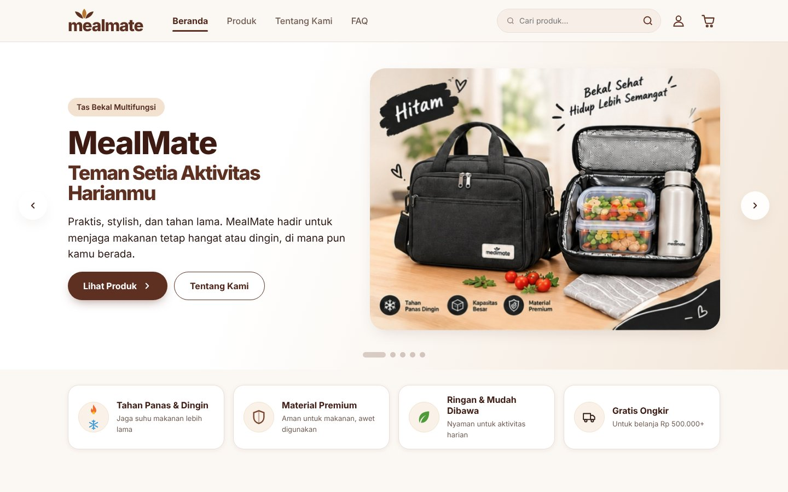
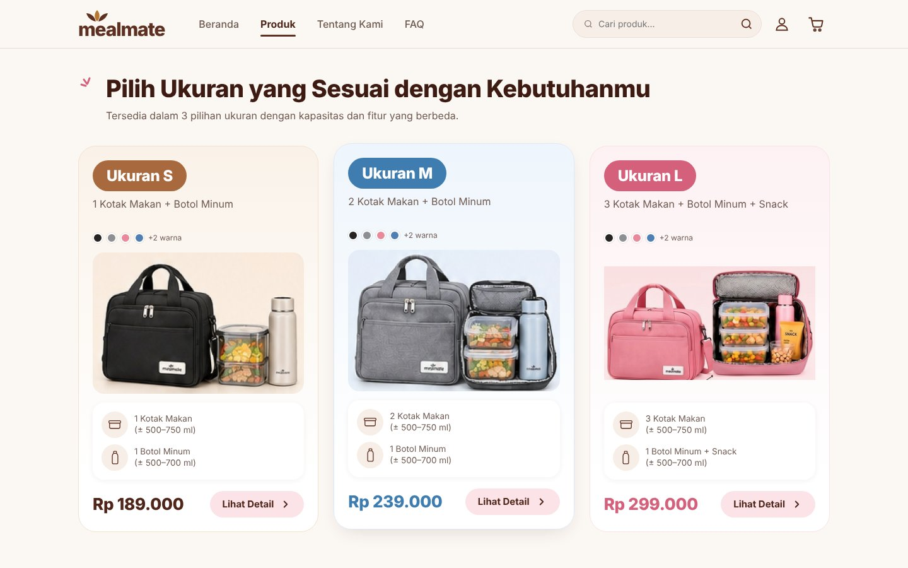
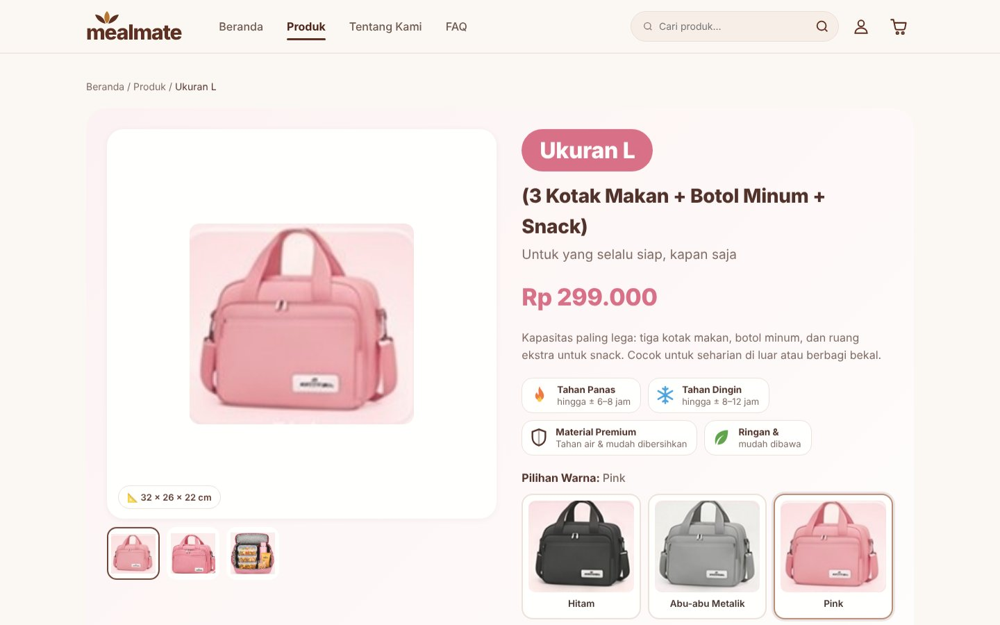
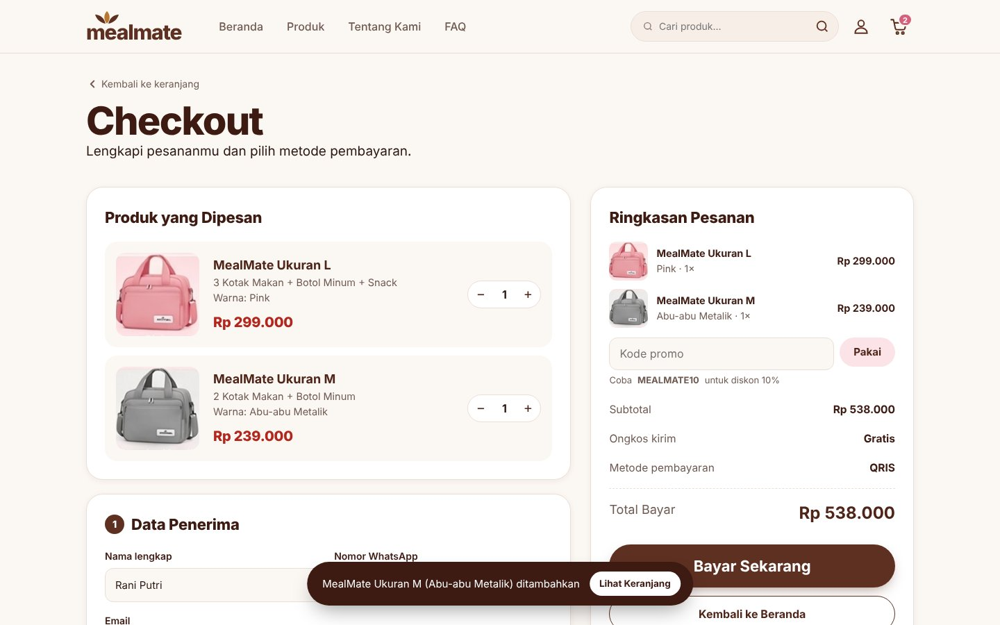
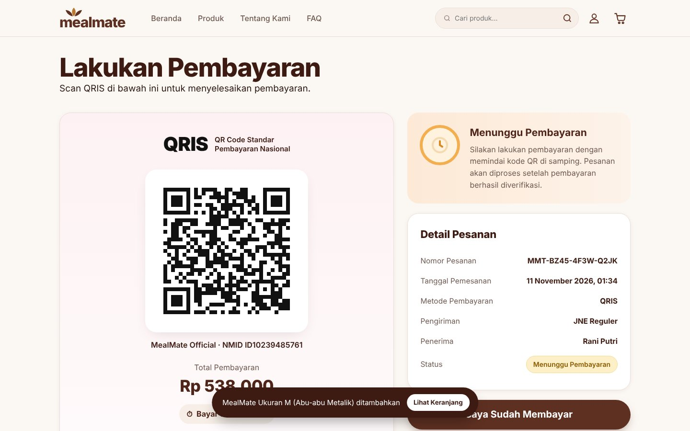
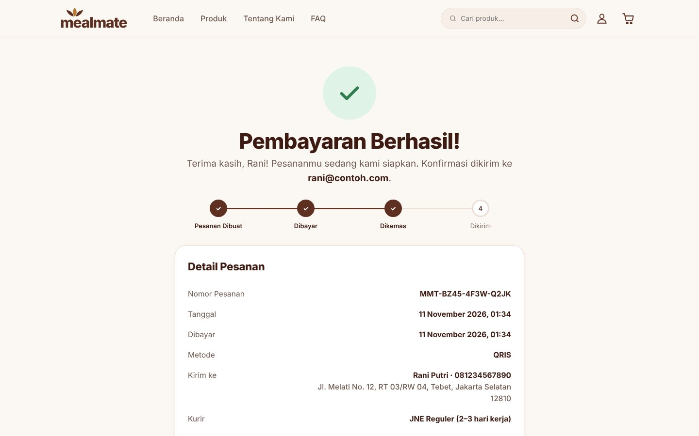
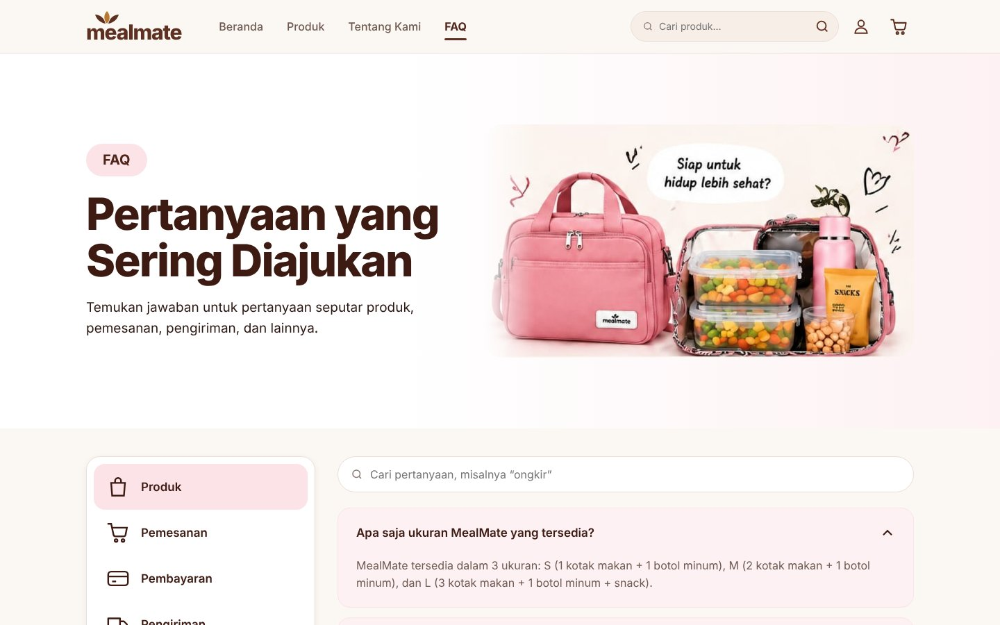
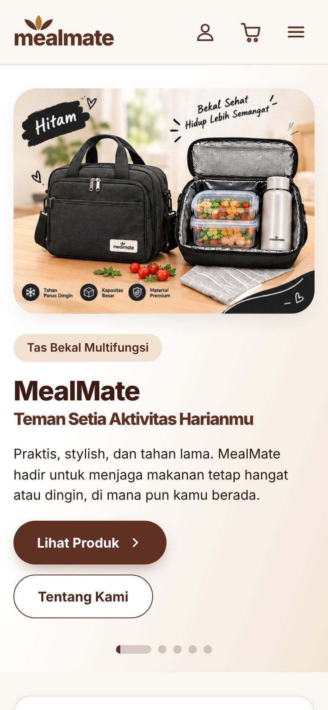
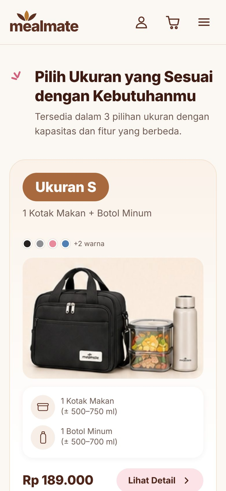
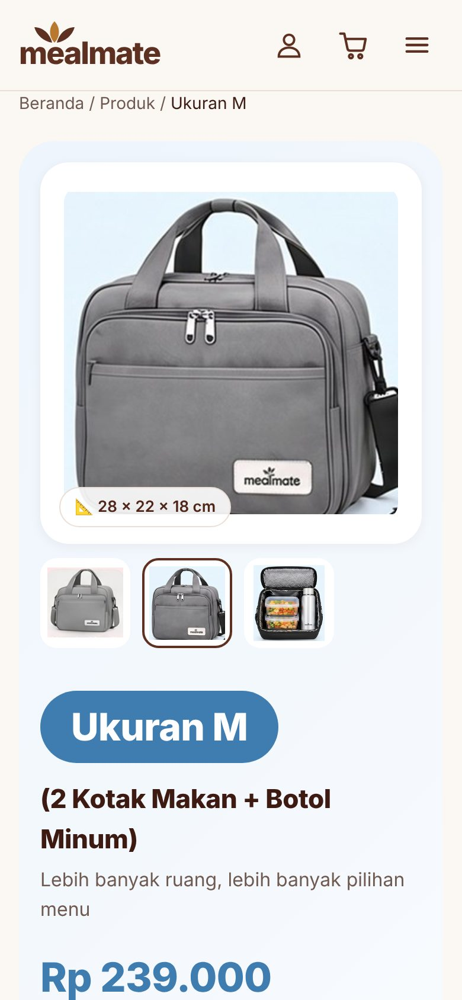

# MealMate — Website Toko Tas Bekal

Website toko online untuk **MealMate**, tas bekal tahan panas dan dingin yang tersedia dalam ukuran S, M, dan L. Proyek ini adalah tugas kuliah berupa implementasi frontend dari desain Figma, mencakup seluruh alur belanja mulai dari melihat produk sampai pembayaran.

**Demo:** https://aaappss-source.github.io/Adhitya-Arya-Putra/mealmate/ &nbsp;·&nbsp; **Desain Figma:** [lihat file desain](https://www.figma.com/design/Pvci7e1kDj5ccJnm2tLCxQ/Untitled?node-id=1-3)



> Pembayaran di website ini adalah **simulasi** untuk keperluan demo. Kode QR dan nomor Virtual Account dibuat oleh aplikasi dan tidak terhubung ke payment gateway, sehingga tidak ada transaksi uang sungguhan.

## Fitur

- **Katalog produk** dengan 3 ukuran, 6 pilihan warna, tabel perbandingan ukuran, dan pencarian produk.
- **Halaman detail produk** dengan galeri foto, pilihan warna, jumlah, info kapasitas, dan dimensi.
- **Keranjang belanja** yang tersimpan di browser (localStorage): ubah jumlah, ganti warna, hapus barang.
- **Checkout** dengan validasi form (nama, nomor HP Indonesia, email, alamat, kode pos), pilihan kurir, kode promo, dan gratis ongkir otomatis untuk belanja di atas Rp500.000.
- **Simulasi pembayaran** QRIS (kode QR dibuat dinamis) dan Virtual Account BCA, Mandiri, BNI, lengkap dengan hitung mundur 15 menit, tombol salin, buat ulang kode, dan pembatalan pesanan.
- **Halaman Pesanan Saya** berisi riwayat dan status pesanan.
- **Banner carousel** di Beranda: berganti otomatis, bisa digeser (swipe/drag), tombol panah, indikator, navigasi keyboard, dan berhenti saat kursor di atasnya.
- **FAQ** dengan kategori dan pencarian pertanyaan.
- **Responsif** untuk HP, tablet, dan desktop.
- **Aksesibilitas dasar**: HTML semantik, label ARIA, fokus keyboard, dan tautan "Lewati ke konten".

Kode promo untuk mencoba: `MEALMATE10` (diskon 10%) dan `BEKALSEHAT` (potongan Rp25.000).

## Tangkapan Layar

| Produk | Detail Produk |
|---|---|
|  |  |
| **Checkout** | **Pembayaran QRIS** |
|  |  |
| **Pembayaran Berhasil** | **FAQ** |
|  |  |

Tampilan HP:

<p>
  
  
  
</p>

## Teknologi

- HTML5, CSS3 (custom properties, Grid, Flexbox), dan JavaScript (ES Modules)
- Tanpa framework dan tanpa build step, jadi bisa langsung di-hosting sebagai situs statis
- [qrcode-generator](https://github.com/kazuhikoarase/qrcode-generator) (MIT) untuk membuat kode QR
- Font Plus Jakarta Sans dan Caveat dari Google Fonts

## Struktur Folder

```
mealmate/
├── index.html              # Kerangka halaman (header, footer, meta SEO & Open Graph)
├── css/
│   └── style.css           # Seluruh gaya: token warna, layout, komponen, responsif
├── js/
│   ├── main.js             # Titik masuk: delegasi event dan inisialisasi
│   ├── router.js           # Router berbasis hash (#produk, #checkout, ...)
│   ├── data.js             # Data produk, warna, kurir, pembayaran, promo, FAQ
│   ├── state.js            # State aplikasi + penyimpanan localStorage
│   ├── utils.js            # Helper: format Rupiah, kalkulasi harga, toast, modal
│   ├── icons.js            # Ikon SVG inline
│   ├── components.js       # Komponen yang dipakai ulang (kartu produk, tabel, ringkasan)
│   ├── cart.js             # Logika keranjang
│   ├── carousel.js         # Banner carousel Beranda
│   ├── pages/              # Satu file per halaman
│   │   ├── home.js  products.js  detail.js  about.js  faq.js
│   │   └── cart.js  checkout.js  payment.js  success.js  orders.js
│   └── vendor/
│       └── qrcode-generator.js
├── assets/
│   ├── img/                # Foto produk
│   ├── favicon.svg, favicon-32.png, apple-touch-icon.png
│   └── og-image.jpg        # Gambar pratinjau saat link dibagikan
└── docs/screenshots/       # Tangkapan layar untuk README
```

## Menjalankan di Komputer

Karena memakai ES Modules, website harus dibuka lewat server lokal. Membuka `index.html` langsung dengan klik dua kali akan menampilkan halaman kosong.

Pilih salah satu cara:

```bash
# Node.js
npx serve .

# Python
python -m http.server 8000
```

Lalu buka `http://localhost:3000` (serve) atau `http://localhost:8000` (Python). Di VS Code, bisa juga memakai ekstensi **Live Server**.

## Deploy

Website ini statis, jadi bisa di-hosting gratis di **Netlify**, **Vercel**, atau **GitHub Pages** tanpa konfigurasi tambahan.

- **Netlify:** buka app.netlify.com/drop, lalu seret folder `mealmate` ke halaman tersebut.
- **GitHub Pages:** unggah isi folder ke repository, buka *Settings → Pages*, pilih branch `main` dan folder root.

## Alur Penggunaan

1. **Beranda** → klik *Lihat Produk*
2. **Produk** → pilih ukuran, klik *Lihat Detail*
3. **Detail** → pilih warna dan jumlah, klik *Tambah ke Keranjang* atau *Beli Sekarang*
4. **Keranjang** → periksa barang, klik *Lanjut ke Checkout*
5. **Checkout** → isi data penerima, pilih kurir dan metode pembayaran, klik *Bayar Sekarang*
6. **Pembayaran** → scan QRIS atau transfer ke VA, klik *Saya Sudah Membayar*
7. **Pembayaran Berhasil** → pesanan tercatat di *Pesanan Saya*

## Pengembangan Selanjutnya

- Menghubungkan pembayaran ke payment gateway (misalnya Midtrans atau Xendit) melalui backend
- Menyimpan pesanan di database agar bisa dikelola penjual
- Login pengguna dan halaman admin

## Kredit

- Desain antarmuka: file Figma MealMate
- Dibuat oleh: Adhitya Arya Putra ([GitHub](https://github.com/aaappss-source))
